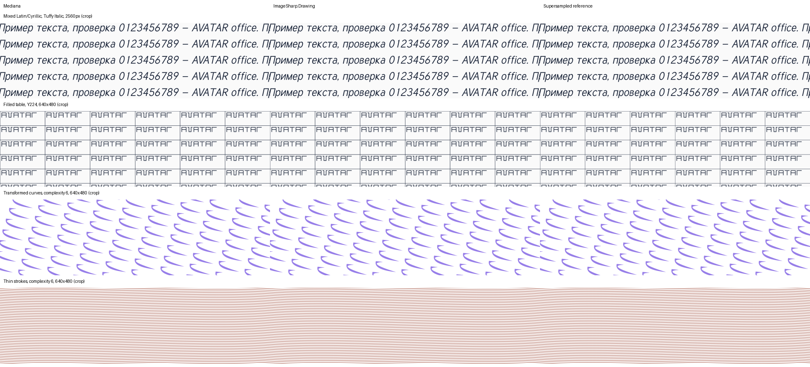

# Drawing performance and quality — 6 November 2026

The overall target is not met. Mediana is within 5% of the reference's elapsed time
or faster in **87 of 111 workloads**. All 60 text/table workloads meet that speed
target and use less managed allocation and lower median peak RSS. Complex curves,
transformed paths and dense thin strokes still miss it. Large mixed-script text
also has an allocation regression despite faster rendering and lower peak RSS.

This comparison covers rendering, layout/measurement used by these scenes, buffer
creation and disposal. Image encoding, file I/O and application startup are outside
the rendering timers. The reference is ImageSharp 4.1.3 + ImageSharp.Drawing 3.1.3 +
Fonts 3.2.0, resolved through EasyExtensions.Drawing 3.0.95 in the comparison project.
Production packages acquire no reference-engine dependency.

| Suite | Workloads | Elapsed time ≤ reference × 1.05 | Allocated bytes ≤ reference × 1.05 | Median peak RSS ≤ reference × 1.05 |
| --- | ---: | ---: | ---: | ---: |
| Four font faces, text and tables | 60 | 60 | 60 | 60 |
| Vectors, two complexity levels | 36 | 15 | 16 | 28 |
| Sustained series, 1/2/4 contexts | 12 | 9 | 9 | 8 |
| 10,240 × 10,240 canvases | 3 | 3 | 2 | 3 |

The memory columns use the same 5% threshold to expose tradeoffs; they are separate
from the elapsed-time pass count. No combined claim of parity across all workloads
follows from the 87/111 speed result. See [every workload](summary.md), including
missed targets, and [process ranges and cold-call timings](summary.json).

## Representative results

Each pair below is **Mediana / reference**. Milliseconds are per image; MiB means
1,048,576 bytes. For concurrent series, elapsed time per image is reciprocal aggregate
throughput, not the latency of an individual request. CPU time sums all process threads.
Allocation is managed allocation per image; RSS is the whole process's peak.

| Scene | Elapsed ms M / R | CPU ms M / R | Allocated MiB M / R | Peak RSS MiB M / R |
| --- | ---: | ---: | ---: | ---: |
| Dense text, Tuffy, 2560², one context | 38.880 / 132.919 | 38.902 / 134.670 | 3.34 / 24.15 | 78.4 / 134.6 |
| Filled 6 × 14 table, Tuffy, 640 × 480 | 12.550 / 72.286 | 12.556 / 72.540 | 1.00 / 54.11 | 54.6 / 89.5 |
| Dense text, 2560², four contexts, 30 s | 27.717 / 82.585 | 66.902 / 251.102 | 3.37 / 24.34 | 220.0 / 302.2 |
| Filled table, 640 × 480, four contexts, 30 s | 5.311 / 41.107 | 16.826 / 128.883 | 1.00 / 57.18 | 63.9 / 100.1 |
| Rounded bars, 2560², four contexts, 30 s | 4.386 / 5.839 | 15.441 / 31.812 | 0.46 / 1.64 | 204.4 / 181.9 |
| Dense thin strokes, 640 × 480, four contexts, 30 s | 2.827 / 1.582 | 8.653 / 7.186 | 2.55 / 0.90 | 119.1 / 79.7 |
| Transformed curves, 200², complexity 1 | 1.944 / 0.542 | 1.945 / 0.545 | 0.34 / 0.27 | 54.7 / 66.1 |

All six rounded-bar and all six overlapping-alpha vector cases meet the time target.
Only three of six clipped-curve cases do. None of the six ordinary-curve, six
transformed-curve or six thin-stroke cases do: their time ratios range from 1.21 to
3.59. Four-context bars illustrate a separate memory tradeoff: faster throughput and
less allocation coexist with about 22.5 MiB higher peak RSS.

### Large surfaces

These scenes have a logical size of 2560² and drawing scale 4: the physical canvas is
10,240². The scale applies to the same geometry, glyph sizes and positions in both engines.

| Scene | Elapsed ms M / R | CPU ms M / R | Allocated MiB M / R | Peak RSS MiB M / R |
| --- | ---: | ---: | ---: | ---: |
| Dense Latin text | 241.862 / 528.608 | 242.315 / 532.624 | 33.46 / 37.99 | 477.0 / 537.8 |
| Mixed Cyrillic/Latin text | 474.664 / 566.637 | 475.410 / 570.477 | 96.89 / 41.54 | 472.3 / 540.3 |
| Rounded bars | 90.123 / 168.796 | 90.135 / 169.191 | 0.86 / 4.96 | 452.8 / 472.8 |

An RGBA8 surface at this size contains **400 MiB of visible pixels**. A shared-pool
rental can have a larger capacity, such as 512 MiB. Reusing it avoids allocation
traffic on subsequent images; it does not remove its physical storage. The allocation
column therefore must not be interpreted as total memory required to render an image.

## Workloads and measurement method

There are 618 measured child processes, grouped into 111 workloads:

- Text and tables: five scenes × three sizes (200², 640 × 480, 2560²) × four faces.
  Scenes contain short text, dense Latin text, mixed Latin/Cyrillic text, a nearly
  empty table and a filled table. Tables have 6 × 14 cells and trim strings with
  repeated width measurement. Three independent process pairs per workload.
- Vectors: six scenes × three sizes × complexity 1 or 6. These draw 20/120 rounded
  bars, 30/180 compound curve shapes, 20/120 thin curved strokes, 80/480 overlapping
  alpha tiles, clipped curves and rotated curves. Three independent process pairs.
- Sustained series: dense text, a filled table, bars and thin strokes, each with
  1, 2 or 4 concurrent contexts. One independent process pair per workload, at least
  30 seconds per process. These series are not three-repetition estimates.
- Large surfaces: dense text, mixed text and bars at 10,240². Three independent
  process pairs, at least three measured seconds each.

Text/vector processes measure at least one second and five batches after warmup.
Each child loads a font once, records the first complete image separately, warms up
for at least 500 ms and three batches, collects garbage, and measures its series.
Each image has its own context and is disposed. Concurrent images share only the
parsed font. Reference drawing uses one recording canvas for the entire image,
including its final flush; its allocator and internal parallelism retain their defaults.

Engine order alternates between adjacent workloads and repetitions. Paired processes
run sequentially with no simultaneous build, test or profiler workload. Each single
context gets `DOTNET_PROCESSOR_COUNT=1`; the sustained suite gets 1, 2 or 4 for both
engines, matching the requested context count. This controls the runtime's processor
allowance, not OS affinity. Tiered compilation is disabled for both engines.

Tables show the median of independent process means and median process peaks. The
JSON summary also retains minimum/maximum means, largest observed peaks, operation
counts, cold-call and font-load medians. Cold calls include rendering initialization
after font construction, but exclude font loading, input-file reading and process
startup. Across the 60 font/table workloads, Mediana's median cold-call ratios range
from 0.13 to 0.27 of the reference. These are different measurements from steady-state
throughput.

Managed allocation uses `GC.GetTotalAllocatedBytes(true)` across all threads; raw
records retain the series total, per-image allocation and generation 0/1/2 collection
counts. Total allocation over a fixed duration depends on how many images finish:
compare per-image values together with the recorded operation count. Native allocation
traffic is not measured. Peak RSS comes from `Process.PeakWorkingSet64` and includes
process startup, font parsing, cold calls, warmup and the measured batch. It is sampled
before concurrency verification and pixel export. Pool-retained capacity and runtime
memory contribute to RSS even when no new managed array is allocated.

The host is Linux x64, Intel Core i5-12450H, 12 available logical CPUs, cgroup quota
11.75 CPUs; SDK 10.0.403 and .NET runtime 10.0.14. This is a shared host. Independent
repetitions and recorded ranges expose variation; a ratio near 1.05 does not establish
a statistical guarantee of parity on other hardware or under other scheduling.

## Image quality and concurrent correctness

All **84 quality cases** pass: all 60 font/table cases and 24 vector cases at 200²
and 640 × 480. Each uses the same geometry, input font, text, baseline and font size.
Both use unhinted fractional coverage; reference `TextContrast` is explicitly zero,
hinting is disabled and DPI is 72. This compares a common coverage model, rather
than the reference's default text appearance. The scenes exercise Latin/Cyrillic
and kerning, not general complex-script shaping or every OpenType feature.

The quality reference renders at 8× for 200px scenes or 4× for larger ones, then
downsamples premultiplied RGBA with a box filter. Native output from each engine is
compared against that same image. The gate is edge RGB RMSE ≤ reference native RMSE
+ one 8-bit code value. Edges are selected from local luminance variation in the
downsampled image; comparison composites on white. Alpha RMSE and direct native-image
differences are recorded separately. The largest excess over reference edge error
is 0.125 code for text/tables and 0.259 for vectors. Maximum whole-image alpha RMSE
is 1.007 codes for Mediana and 0.997 for the reference in transparent vector scenes.

Tables draw a border for each cell, so shared edges are drawn twice in both engines.
This produces high absolute edge RMSE against the supersampled image in some table
cases, even though native outputs are similar. The gate is relative and does not
establish pixel identity. Native-resolution crops of italic mixed text, the table,
transformed curves and thin strokes were also visually inspected:



The 2560px vector scenes and 10,240px canvases have performance results but no separate
supersampled quality results in this run. The 84 passing cases do not imply complete
quality coverage of all 111 performance workloads.

Every sustained parallel process reached its requested concurrency. After timing and
memory sampling, it renders two images per worker and compares their complete SHA-256
pixel hashes with a single-context image from that engine. All checks pass; the raw
`VerifiedConcurrentImages` and `ObservedParallelism` fields retain this evidence.
These checks establish repeatability within an engine, not equality between engines.

## Changes and remaining work

The measured implementation includes analytic antialiased coverage at output resolution;
bounded glyph geometry and fractional-placement coverage caches; active-edge and
covered-row bounds; SIMD for solid and fractional coverage spans; compact miter/butt
stroke boundaries; and cleared, budgeted BCL pool leases for pixel storage. SIMD
compositing preserves scalar rounding, including transparent and opaque destinations.

Applications select `FillPathAntialiased`, `StrokePathAntialiased` and
`DrawGlyphAntialiased` to obtain the tested coverage without a supersampled canvas.
The existing binary-coverage methods keep their behavior. Share `FontProgram` across
previews and use a separate `TextRenderer` and buffer per context; see
[text rendering](../../../../docs/text-rendering.md). These results must not be
presented as an automatic replacement of every existing client's supersampling path.

The remaining costs have concrete locations in the implementation:

- Thin-stroke processing constructs several intermediate representations: flattened
  points, an outlined path, flattened outline contours and raster edges. Stroke
  workloads allocate about 2–2.9× the reference. Reusing prepared stroke geometry and
  reducing these conversions is the next structural target.
- Complex antialiased paths still generate row events, sort crossings and integrate
  changing winding intervals. Curves and rotated curves remain slower. This requires
  algorithmic work in path preparation and coverage, beyond faster pixel blending.
- Clipping retains a byte for every canvas pixel. A 2560² clip adds 6.25 MiB before
  the path's own workspace. Dense clipped curves at 2560² take 26.06 / 30.40 ms, yet
  allocate 9.38 / 3.61 MiB and peak at 180.8 / 94.1 MiB.
- Large mixed text allocates 96.89 / 41.54 MiB. The glyph coverage cache clears when
  its pixel budget is exceeded, and its masks use floats. Large glyphs and many
  fractional positions can therefore repeatedly create masks. Admission/eviction
  and mask representation need further work without reducing edge quality.
- Reused pool storage can increase retained memory in concurrent drawing; the bar
  series demonstrates this even with fewer allocated bytes per image.

These are code-level costs consistent with the measurements; no profiler attribution
percentage is claimed for them. The speed and memory target remains open for these
workloads.

Local Release validation passed 3,612 main tests and 199 WebP tests. Another 37 focused
tests passed with hardware intrinsics disabled. Full linux-x64 Native AOT publishing
and the native validation executable passed. Two additional wide-scanline partition
cases passed after widening their test geometry. License headers, C# whitespace,
Python formatting and strict Python type checking passed.

## Reproduction and evidence

The metadata files identify source revision `5770797eac60f1787834ad229364680d4dfa5933`,
the measured executable and drawing assembly hashes, exact package/runtime versions,
and each suite's duration/repetition settings. The four fonts are supplied externally;
their bytes are identified in raw records by SHA-256:

| File | SHA-256 |
| --- | --- |
| Y224.ttf | 328EA4041EE468AE18255318029E386E9D952EF43FA4D6E10F11723F244826C8 |
| Tuffy.ttf | B97CD5005278B24AABB69B8B6EAD98860955599558F6E8119483B575A5FDCE98 |
| TuffyBold.ttf | EAD68BA8BEF71D5F6411F2A585DCA28A15DC7E5B7729FD64B9FAFF05730DDFDE |
| TuffyItalic.ttf | 94313DC6018E1F9B39AEC9C9E4DD7E603320D47D7B1F30EA24E111D7B9EF2FB6 |

Run from the repository root, supplying a directory containing these four files:

```sh
DOTNET_PROCESSOR_COUNT=2 dotnet build benchmarks/Mediana.DrawingComparison -c Release -o artifacts/drawing-comparison/current
python benchmarks/Mediana.DrawingComparison/run_comparison.py --dotnet '<dotnet>' --binary artifacts/drawing-comparison/current/Mediana.DrawingComparison.dll --font-directory '<font-directory>' --suite fonts --repeats 3 --seconds 1 --output artifacts/drawing-comparison/fonts-final.jsonl
python benchmarks/Mediana.DrawingComparison/run_comparison.py --dotnet '<dotnet>' --binary artifacts/drawing-comparison/current/Mediana.DrawingComparison.dll --font-directory '<font-directory>' --suite vectors --repeats 3 --seconds 1 --output artifacts/drawing-comparison/vectors-final.jsonl
python benchmarks/Mediana.DrawingComparison/run_comparison.py --dotnet '<dotnet>' --binary artifacts/drawing-comparison/current/Mediana.DrawingComparison.dll --font-directory '<font-directory>' --suite series --repeats 1 --seconds 30 --output artifacts/drawing-comparison/series-final.jsonl
python benchmarks/Mediana.DrawingComparison/run_comparison.py --dotnet '<dotnet>' --binary artifacts/drawing-comparison/current/Mediana.DrawingComparison.dll --font-directory '<font-directory>' --suite large --repeats 3 --seconds 3 --output artifacts/drawing-comparison/large-final.jsonl
python benchmarks/Mediana.DrawingComparison/summarize_results.py --output artifacts/drawing-comparison/summary artifacts/drawing-comparison/fonts-final.jsonl artifacts/drawing-comparison/vectors-final.jsonl artifacts/drawing-comparison/series-final.jsonl artifacts/drawing-comparison/large-final.jsonl
```

Use fresh output paths: the runner rejects existing measurement files. Quality
commands and Pillow requirements are in the [comparison instructions](../../README.md).
The [raw text](fonts-final.jsonl), [vectors](vectors-final.jsonl),
[sustained series](series-final.jsonl), [large surfaces](large-final.jsonl),
[font quality](quality-fonts.jsonl) and [vector quality](quality-vectors.jsonl)
files retain all recorded outcomes.

The common text settings follow the reference's
[TextOptions](https://docs.sixlabors.com/api/Fonts/SixLabors.Fonts.TextOptions.html)
and [text layout](https://docs.sixlabors.com/articles/fonts/textlayout.html) contracts;
drawing uses its [canvas API](https://docs.sixlabors.com/articles/imagesharp.drawing/gettingstarted.html).
Analytic area coverage is described in
[scanline rasterization notes](https://www.nothings.org/gamedev/rasterize/).
