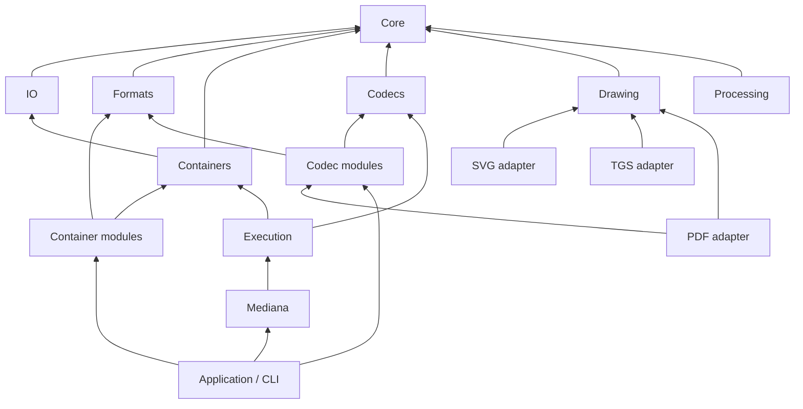

# Module contracts and execution

Mediana separates encoded data, decoded frames, format syntax and operation
execution. Register concrete modules explicitly; the facade does not scan
assemblies or require an application service container.



The diagram shows the main dependency boundaries. Image adapters also implement
codec contracts, and HLS composes its required container and codec modules.
Architecture tests check the project graph for cycles, foundation dependencies,
container/codec separation and inclusion of every library in release packaging.

## Encoded stream representation

`EncodedStreamInfo` carries a codec identifier and an `EncodedStreamFormat`.
The latter identifies configuration syntax, packet framing and boundary semantics:
`AccessUnit`, `SampleBlock` or `ArbitraryBytes`. These are independent of the codec
implementation. Identifier strings are ordinal and case-sensitive, so additional
format modules can define representations without modifying a central codec enum.

`Mediana.Formats.StreamFormats` declares the representations used by existing
modules. An MP4 AVC stream uses an AVC decoder configuration record and
length-prefixed access units; its codec identifier alone does not describe those
bytes. Decoder factories and writers check the representation before parsing
configuration or writing output. `AvcAnnexBConverter` and `AacAdtsConverter` provide
explicit access-unit framing conversion. They do not discover picture boundaries
in an arbitrary byte stream.

`Mediana.Core` contains time, ownership and stream/frame types. Parsing AAC, MP3,
FLAC and PCM configuration belongs to `Mediana.Formats`, shared by readers,
decoders and output modules without introducing container-to-codec dependencies.

## Media inspection

`MediaEngine.ProbeAsync` uses the registered content recognizers for packet
containers and complete-file images. Recognized images take precedence over a
generic container signature, such as the ISO BMFF signature shared by MP4 and HEIF.
An ambiguous image match fails; a parser failure is not retried as another format.

Image adapters implement the optional `IImageInfoReader` capability. Inspection
reads declarations without invoking pixel decoding or rendering. SVG shares viewport
parsing with rendering; JPEG 2000 and JBIG2 share their structural header readers
with decoding. PDF exposes the first page's visible size in points, HEIF applies
container crop/orientation to the declared dimensions, and TGS/Lottie exposes canvas
dimensions and composition timing.

`MediaInfo` contains exactly one of `Container` and `Image`. Image results have
empty `Streams` and `StreamMetadata` collections; they do not invent packet streams.
Metadata survives source disposal. Random access inspection preserves the source
cursor; sequential probing replays the recognized prefix. Container inspection does
not scan encoded packets. Image readers may inspect the entire input, bounded by
`MaxImageInputBytes`; encoded buffers share `BufferBudgetBytes`, and each module
retains its own parsing-work limits. A successful probe describes declared metadata
and does not guarantee support for every encoded feature.

## Container pictures

`IContainerPictureReader` is an optional reader capability implemented by MP3,
FLAC and MP4/M4A. `ContainerSession.Pictures` returns immutable declarations in
container order. Null means the reader does not expose this capability; an empty
list means no pictures were found in the inspected metadata. A picture does not
become a timed video stream or an attachment merely because it is embedded.

`ReadPictureAsync(index)` returns an owned view of the original bytes without
moving packet cursors. No image decoder or output encoder is involved. The lease
survives session disposal and accounts for the full backing metadata allocation,
including bytes outside the picture slice. Repeated extraction shares storage.
The session borrows its source and rejects concurrent picture, packet or disposal calls.
An invalid index leaves it usable; cancellation or a reader failure faults it.

Declarations retain media type, description and ID3/FLAC picture type when present.
They do not validate the image encoding or choose a preferred cover. The format's
reader retains its detailed metadata API. External reference bytes remain data;
there is no automatic network or file retrieval. ID3 APIC and FLAC PICTURE define
the `-->` marker for this case: [ID3v2.4 §4.14](https://id3.org/id3v2.4.0-frames),
[RFC 9639 §8.8](https://www.rfc-editor.org/rfc/rfc9639.html#section-8.8).

The CLI uses the same registered container recognizers and session capability for
`cover input output`. Its explicitly named container commands share the executor
and verify the detected container. File replacement remains an application policy.

## Encoding and copying

`IMediaEncoder<TFrame>` extends the codec send/receive protocol and exposes its
encoded output stream before input is sent. Encoder factories validate the input
format, time base and module options at creation. Writer factories validate output
stream declarations before destination I/O.

Register output factories with `AddAudioEncoder`, `AddVideoEncoder` and
`AddContainerWriter`. A built engine owns a snapshot of those registrations.
Create encoders by codec identifier and writers by container identifier; module
options belong to the registered factory.

`MediaOperations.EncodeAudioAsync`, `EncodeVideoAsync` and `CopyAsync` perform
complete operations. `MediaEncodePipeline<TFrame>` provides incremental encoding
for callers coordinating several sources or segmented outputs. It drains all
available packets before accepting more input, handles delayed/multiple output,
and drains the encoder after `CompleteInput`. Completing that incremental pipeline
does not complete the writer; the caller finalizes it after all streams finish.
The complete `MediaOperations` methods finalize the writer on success.

Operations borrow readers, encoders and writers. A frame-read callback transfers
ownership of each returned frame to the operation. Output packets are disposed
after their asynchronous write completes. On failure the caller disposes borrowed
components and decides how to discard or replace the destination. File selection,
overwrite confirmation, atomic file replacement and console logging belong to the
application.

Progress is `MediaOperationProgress`: submitted frames, written packets, encoded
payload bytes, processed duration when known, and successful completion. Payload
bytes exclude container overhead. `MediaTimeEstimator` consumes known duration
and observed processing pace; unknown duration does not imply a fabricated ETA.

The [transcode sample](../samples/Mediana.Sample/TranscodeSample.cs) calls the same
encoding operation used by the CLI:

```sh
dotnet run --project samples/Mediana.Sample -c Release -- --transcode input.mp4 output.ts
```

It transcodes the selected video track through registered H.264 and MPEG-TS
modules. It creates a new output file and leaves audio selection, resizing and
file replacement to applications needing those policies.

## One demuxer for audio and video

`MediaEngine.OpenMediaAsync` opens one reader and independent decoders for all
A/V streams or an explicit selection. `MediaSession.ReadFrameAsync` returns an
owned `DecodedMediaFrame` with `StreamIndex`, `Kind` and a typed audio/video frame.
Disposing the envelope releases its frame; retain the underlying frame when it
must outlive that envelope.

```csharp
await using MediaSession session = await engine.OpenMediaAsync(source);
while (true)
{
    using DecodedMediaFrame? decoded = await session.ReadFrameAsync(cancellationToken);
    if (decoded is null)
    {
        break;
    }
    // Consume decoded.Audio or decoded.Video according to decoded.Kind.
}
```

This uses `Mediana` and `Mediana.Execution`; the engine needs the input's reader
and decoder registrations. `MediaDecodeGroup` is the lower-level equivalent for
an existing reader and explicit `MediaDecodeTrack` instances.

The group reads another packet only when all active decoders need input. There
is no intermediate packet queue or background prefetch, so pausing the consumer
stops input reads. EOF completes every decoder and then drains all tracks.
Cancellation or a decoding failure terminates the session and releases its decoder
state. Returned frames retain independent ownership.

Ordering is preserved within each stream, including decoder reordering. Frames
from different streams are not globally sorted by presentation timestamp: a
player or other synchronizing consumer owns the presentation clock. The source is
borrowed and must support the selected container reader's access requirements.
Media allocation budgets bound owned media buffers, not the entire process heap.

## Shared drawing

`Mediana.Drawing` owns vector paths, scene rendering, paints, masks, effect graphs,
RGBA buffers and TrueType outlines. SVG interprets XML/CSS into that scene; TGS
interprets evaluated Lottie properties directly into it. PDF uses drawing and font
contracts without referencing SVG internals. `DrawingRenderOptions` supplies output
size, supersampling, background and resource budgets to SVG and TGS renderers.

Scene and effect execution are internal to Drawing; the public format adapters
expose document/frame APIs. An effect graph tracks named inputs and the last use
of temporary buffers. Each render owns its context, cancellation token and memory
budget. No XML or SVG parser is required by Drawing or TGS.
