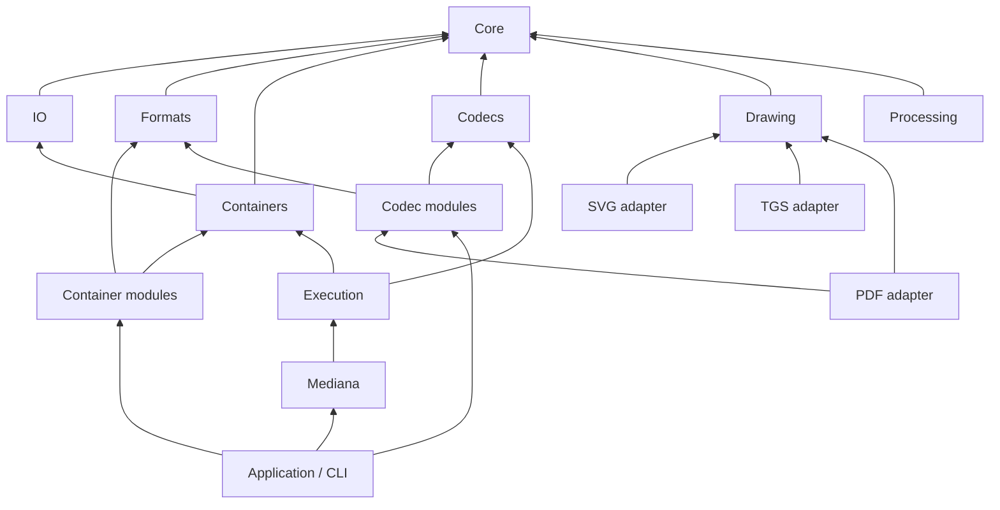

# Module contracts and execution

Mediana separates encoded data, decoded frames, format syntax and operation
execution. Register concrete modules explicitly; the facade does not scan
assemblies or require an application service container.



The diagram shows the main dependency boundaries. Image adapters also implement
codec contracts, and HLS composes its required container and codec modules.
Architecture tests check the project graph for cycles, foundation dependencies,
container/codec separation and inclusion of every library in release packaging.

## Encoded stream representation

`EncodedStreamInfo` carries a codec identifier and an `EncodedStreamFormat`.
The latter identifies configuration syntax, packet framing and boundary semantics:
`AccessUnit`, `SampleBlock` or `ArbitraryBytes`. These are independent of the codec
implementation. Identifier strings are ordinal and case-sensitive, so additional
format modules can define representations without modifying a central codec enum.

`Mediana.Formats.StreamFormats` declares the representations used by existing
modules. An MP4 AVC stream uses an AVC decoder configuration record and
length-prefixed access units; its codec identifier alone does not describe those
bytes. Decoder factories and writers check the representation before parsing
configuration or writing output. `AvcAnnexBConverter` and `AacAdtsConverter` provide
explicit access-unit framing conversion. They do not discover picture boundaries
in an arbitrary byte stream.

`Mediana.Core` contains time, ownership and stream/frame types. Parsing AAC, MP3,
FLAC and PCM configuration belongs to `Mediana.Formats`, shared by readers,
decoders and output modules without introducing container-to-codec dependencies.
The same module owns H.264 RBSP reading/writing and SPS/VUI syntax; the decoder
uses these headers while retaining reconstruction and reference-picture state.

`WritableMediaBuffer.Span` provides a checked borrowed view for synchronous
computation; `Memory` supports asynchronous I/O. Both views share the owned
allocation. Publication transfers ownership to a read-only lease and invalidates
further writable access. Borrowed writable views must not outlive publication
or disposal.

## Source pixel geometry

`EncodedStreamInfo.AspectRatioDescription` carries a source pixel aspect ratio
without changing codec configuration. Explicit declarations override the codec;
a format default applies only when the codec leaves its ratio unspecified.
The H.264 decoder resolves this description for every output frame, including
in-band SPS changes. Opening SPS metadata keeps the original declarations.

MP4/MOV reads `pasp` horizontal/vertical spacing as an exact reduced ratio.
Zero spacing, malformed lengths and duplicate boxes are rejected. QuickTime
without `pasp` provides a square-pixel format default, following its
[pixel aspect ratio extension](https://developer.apple.com/documentation/quicktime-file-format/pixel_aspect_ratio).
The default does not replace an explicit non-square H.264 VUI declaration.
ISO MP4 without `pasp` retains unknown container geometry. Processing still
requires a known aspect ratio and does not guess it from resolution.

TS/HLS stream copying writes the resolved source aspect ratio into every SPS
from `avcC` and replaces its known in-band occurrences. Existing codec ratios
survive format defaults. Unchanged aspect-only SPS data stays byte-identical;
PPS, SEI and coded slices are preserved. An unrepresentable ratio fails before
destination I/O. Color and geometry use one bounded SPS rewriting pass.

## Source color descriptions

`EncodedStreamInfo.ColorDescription` carries an immutable source description
independently of the codec configuration. The H.264 decoder passes it to each
`VideoFormat.ColorDescription` without applying a pixel transform.
`VideoFormat.Color` continues to describe codec labels;
`GetColorInterpretation()` applies the source description's precedence.
Opening SPS metadata remains unchanged.

MP4/MOV reads ordered `colr` boxes from the visual sample entry. The reader
selects the first recognized CICP description, or the first ICC description when
there is no CICP alternative. `Mp4TrackInfo.ColorDescriptions` retains all
recognized alternatives in their original order. Unknown color types are ignored.
The selection and precedence follow [ISO BMFF color information](https://cdn.standards.iteh.ai/samples/55969/793ac5ceebdc4c969abb2fe52ebd9368/ISO-IEC-14496-12-2008-FDAmd-2.pdf).

`CicpColorDescription` retains the original 16-bit primaries, transfer and matrix
codes. Code 2 remains unspecified even when it overrides codec labels; reserved
codes remain inspectable and fail color interpretation. An `nclx` description
declares full or limited range. QuickTime `nclc` has no range field and preserves
the codec's range: [QuickTime color parameter atom](https://developer.apple.com/documentation/quicktime-file-format/color_parameter_atom).
Neither description changes chroma siting.

`IccColorDescription` owns original profile bytes and retains the restricted
profile declaration. Profile contents are neither validated nor applied.
Raw packet and frame decoding remain available; current color interpretation
rejects ICC-only sources. Copied profile data is bounded by MP4's metadata input
limit and is shared by stream/frame descriptions, outside the pooled buffer budget.

Default `SrgbConverter` and `SrgbPreview` operations resolve the source description
before conversion. Explicit source-color overloads use the caller's interpretation.
Sample-domain resizing preserves the description; sRGB conversion produces a frame
with sRGB labels and no source description. PNG validates the effective color;
the H.264 encoder writes the effective CICP labels into its own SPS.

The CLI probes original container codes separately from codec metadata and only
infers missing SDR labels after resolving the source description. Reserved codes,
ICC profiles and declared HDR characteristics do not become missing SDR metadata.
MPEG-TS and HLS stream copying express a source CICP description in every AVC SPS.
`H264ColorDescriptionWriter` replaces the video signal fields and preserves all
other RBSP syntax, including SAR, timing, HRD, chroma location and buffering.
The shared `AvcAnnexBConverter` prepares configuration SPS parameters once and
substitutes the same bytes for known in-band SPS occurrences. Coded slices, PPS
and auxiliary NAL payloads remain unchanged. Unknown parameter changes require
a new converter. An absent source range preserves each SPS range independently;
explicit code 2 stays unspecified. ICC-only and unrepresentable CICP descriptions
fail writer creation before destination I/O. Declared HDR can be copied without
pixel conversion. Rewriting uses the media allocator and a per-SPS output limit;
retained original and rewritten parameter arrays are managed configuration data
outside the pooled buffer budget.

## Media inspection

`MediaEngine.ProbeAsync` uses the registered content recognizers for packet
containers and complete-file images. Recognized images take precedence over a
generic container signature, such as the ISO BMFF signature shared by MP4 and HEIF.
An ambiguous image match fails; a parser failure is not retried as another format.

Image adapters implement the optional `IImageInfoReader` capability. Inspection
reads declarations without invoking pixel decoding or rendering. SVG shares viewport
parsing with rendering; JPEG 2000 and JBIG2 share their structural header readers
with decoding. PDF exposes the first page's visible size in points, HEIF applies
container crop/orientation to the declared dimensions, and TGS/Lottie exposes canvas
dimensions and composition timing.

`MediaInfo` contains exactly one of `Container` and `Image`. Image results have
empty `Streams` and `StreamMetadata` collections; they do not invent packet streams.
Metadata survives source disposal. Random access inspection preserves the source
cursor; sequential probing replays the recognized prefix. Container inspection does
not scan encoded packets. Image readers may inspect the entire input, bounded by
`MaxImageInputBytes`; encoded buffers share `BufferBudgetBytes`, and each module
retains its own parsing-work limits. A successful probe describes declared metadata
and does not guarantee support for every encoded feature.

Movies explicitly declaring QuickTime compatibility accept both classic `meta`
atoms and version-0 ISO-style metadata boxes. The initial zero version/flags word
selects the full-box form; other QuickTime payloads start directly with child
atoms. ISO-only and unbranded files still require the full-box header. This follows
Apple's [metadata atom structure](https://developer.apple.com/documentation/quicktime-file-format/metadata_atom).

`ContainerInfo.StreamInfo` exposes container facts keyed by encoded stream index.
Track text tags retain their native keys and scope; they are independent of global
tags and codec header metadata. A declared track duration retains the container's
clock. Optional `ContainerPacketIndexInfo` totals describe a complete packet index:
packet count, compressed payload bytes and the sum of decode durations. They do not
count decoded pictures or PCM samples, apply presentation edits, or define a rate
when their duration is zero. Null metadata means unavailable; an inspected empty
collection remains distinct. All snapshots survive reader and source disposal.

`ContainerPacketIndexInfo.AveragePayloadBitRate` exposes the approximate mean
encoded payload bits per second using those same complete-index byte and duration
totals. Packet framing is included; container overhead is excluded. A zero decode
duration returns null, while zero payload over a positive duration returns zero.
The original integer counters and rational duration remain available. The CLI
uses this common property without recalculating the rate from movie duration.

`ContainerStreamInfo.AverageFrameRate` is optional container-index video timing,
separate from codec configuration timing and decoded output frames. `FrameRate`
retains an exact positive fraction with 128-bit terms. MP4 derives the mean coded
picture rate from complete video sample count and summed `stts` decode durations;
audio packets do not receive a video rate. Empty counts and zero intervals expose
no rate. Movie/track duration declarations, edit lists and timestamp-mode changes
do not replace that original index statistic. An average does not assert constant
cadence or a presentation display rate.

Native text tags can carry `SourcePath`, a structural container location rather
than a filesystem path. MP4 preserves movie, track and media `meta` locations and
their value order. Track values remain separate from movie tags; original typed
bytes are accessible with `Mp4Reader.ReadTrackMetadataValue`. Text/value budgets
apply to the whole movie, including all tracks and decoded metadata key names.

MP4/MOV also reads UTF-8 `udta/name` and localized `udta/tnam` names, preserving
their position among typed metadata values in the common tag list. `MediaTag.Language`
qualifies the text independently of the stream language and the opaque locale field.
`tnam` retains its original packed ISO 639-2/T code; invalid codes do not inherit the
track language. Its terminated UTF-8 or BOM-marked UTF-16BE text follows Apple's
[track name declaration](https://developer.apple.com/documentation/quicktime-file-format/track_name_atom).
`Mp4Reader.UserData` and `Mp4TrackInfo.UserData` describe these atoms separately
from typed `data` values. Their read methods return the complete original payload,
including string framing, through the same retained movie storage and ownership
rules. Unknown user-data atom types are ignored.

`ContainerStreamInfo.Language` contains the selected declared language identifier.
MP4 also exposes original `mdhd` codes and `elng` strings in `Mp4TrackInfo.Language`.
A well-formed extended tag has priority; malformed extended tags retain their
original bytes as Latin-1 code points and yield an unknown selected language.
The parser checks [RFC 5646 syntax](https://www.rfc-editor.org/rfc/rfc5646) without
registry access or identifier canonicalization. Packed ISO 639-2/T codes retain
their spelling. Macintosh code interpretation requires an explicit QuickTime major
or compatible brand; unbranded files retain those codes without inventing a
language. Original `ftyp` major brands are available as `Mp4Reader.MajorBrand`.
See Apple's [language codes](https://developer.apple.com/documentation/quicktime-file-format/language_code_values),
[extended tags](https://developer.apple.com/documentation/quicktime-file-format/extended_language_tag_atom)
and [file types](https://developer.apple.com/documentation/quicktime-file-format/file_type_compatibility_atom).

MP4 computes these totals during its existing sample-table validation, without a
second index pass or packet payload scan. Indexed decode duration also supplies
`EncodedStreamInfo.CodedDuration`; `mvhd`, `tkhd`, `mdhd` and edit declarations
remain separate. Both media and linear-movie timestamp modes retain the original
duration clock, including after MP3 configuration is inferred from its frame header.

QuickTime-compatible movies interpret composition offsets as signed values,
including version-0 `ctts` atoms. ISO-only and unbranded version-0 tables retain
unsigned offsets; version 1 is signed in both formats. Sequential reads, random
sample access and seek-point lookup use the same table interpretation. In media
mode, decode time starts at zero and presentation time adds the declared offset, without
shifting decode time to make offsets nonnegative. See Apple's
[composition offset definition](https://developer.apple.com/documentation/quicktime-file-format/composition_offset_atom).

Linear-movie mode also advances each track's decode schedule by the largest
negative composition offset in its complete sample table. Presentation times and
durations retain the exact edit mapping; no sample is removed. This makes decode
time no later than presentation time while preserving decode intervals. Sequential
merging orders packets by these adjusted decode times, and random access exposes
the same schedule. Media mode retains the original zero-based decode schedule.
The lead is calculated during table validation without reading encoded media or
depending on an optional `cslg` summary.

`ContainerInfo.Dates` and `ContainerStreamInfo.Dates` expose immutable calendar
metadata separately from text and packet timestamps. Each `MediaDateTimeTag`
retains its native key, structural location and UTC or unspecified time-zone kind;
machine-local dates are rejected. Null means unavailable; empty means no specified,
representable date was found. MP4 keeps movie `mvhd`, track `tkhd` and media `mdhd`
dates distinct. Original unsigned 32/64-bit seconds remain available through
`Mp4HeaderDates`; zero is omitted from calendar projections as an interoperability
convention, and values beyond `DateTime` remain numeric declarations. There is no
pre-1970 Unix reinterpretation. ISO BMFF dates use UTC under ISO/IEC 14496-12
§6.2.2. QuickTime-compatible and unbranded files retain an unspecified time zone:
Apple's [header date definition](https://developer.apple.com/documentation/quicktime-file-format/movie_header_atom/creation_time)
recommends UTC without requiring it.

QuickTime version-1 `mp4a` sound descriptions use the same encoded AAC stream
contract after explicit `wave/esds` extraction. Compression ID -2 is required for
compressed-frame sample tables; legacy uncompressed-sample table semantics are
rejected. Reserved variable-rate packet/frame byte counts must be zero and the
`frma` declaration must match `mp4a`. Configuration, packet bytes and sample-table
timing are preserved; the extension's nominal samples-per-packet field does not
replace indexed durations.

Version-2 `mp4a` descriptions read their extended integer-valued IEEE-754 sample
rate and 32-bit channel count, rather than legacy placeholder fields. The 72-byte
structure, reserved constants and variable-rate compressed-audio fields are
validated before reading `wave/esds`. Codec configuration still defines decoded
audio; declared packet-frame counts do not replace indexed durations. Fractional,
non-finite or out-of-range declarations and unknown structure sizes are rejected.
See Apple's [version-2 sound description](https://developer.apple.com/documentation/quicktime-file-format/sound_sample_description_version_2).

For compressed AAC, the AudioSpecificConfig remains definitive for sample rate
and channel layout. The original integer sample-rate declaration remains visible
on `Mp4TrackInfo`, including zero; a zero container declaration does not invalidate
the coded configuration. This follows ISO/IEC 14496-12:2015 §12.2.3.1:
[audio sample-entry semantics](https://b.goeswhere.com/ISO_IEC_14496-12_2015.pdf).

## Container pictures

MP4/MOV reads one self-contained `url ` or `alis` data reference per track.
Both require version 0 and exactly the self-reference flag. Chunk locations must
still lie inside this file's media-data ranges. External aliases, URLs and
resource-fork references are rejected without opening another source. These rules
follow Apple's [data reference declaration](https://developer.apple.com/documentation/quicktime-file-format/media_data_reference_atom/data_references).
Visual sample-description extensions accept the optional four-zero-byte terminator
defined by Apple's [video sample description](https://developer.apple.com/documentation/quicktime-file-format/video_sample_description).
This termination rule does not apply to movie, track or sample-table box lists.
QuickTime `udta` lists independently allow their specified four-byte zero terminator:
[user data atoms](https://developer.apple.com/library/archive/documentation/QuickTime/QTFF/QTFFChap2/qtff2.html).

QuickTime `tmcd` tracks remain data streams with their original sample-description
fields, packet bytes and indexed clocks. They are not video pictures and receive
no average video frame rate. The `QuickTimeTimecode32` representation identifies
big-endian 32-bit counter samples; interpreting tape labels and drop-frame rules
remains separate from reading the container. See Apple's [timecode description](https://developer.apple.com/documentation/quicktime-file-format/timecode_sample_description).

`IContainerPictureReader` is an optional reader capability implemented by MP3,
FLAC and MP4/M4A. `ContainerSession.Pictures` returns immutable declarations in
container order. Null means the reader does not expose this capability; an empty
list means no pictures were found in the inspected metadata. A picture does not
become a timed video stream or an attachment merely because it is embedded.

`ReadPictureAsync(index)` returns an owned view of the original bytes without
moving packet cursors. No image decoder or output encoder is involved. The lease
survives session disposal and accounts for the full backing metadata allocation,
including bytes outside the picture slice. Repeated extraction shares storage.
The session borrows its source and rejects concurrent picture, packet or disposal calls.
An invalid index leaves it usable; cancellation or a reader failure faults it.

Declarations retain media type, description and ID3/FLAC picture type when present.
They do not validate the image encoding or choose a preferred cover. The format's
reader retains its detailed metadata API. External reference bytes remain data;
there is no automatic network or file retrieval. ID3 APIC and FLAC PICTURE define
the `-->` marker for this case: [ID3v2.4 §4.14](https://id3.org/id3v2.4.0-frames),
[RFC 9639 §8.8](https://www.rfc-editor.org/rfc/rfc9639.html#section-8.8).

The CLI uses the same registered container recognizers and session capability for
`cover input output`. Its explicitly named container commands share the executor
and verify the detected container. File replacement remains an application policy.

## Encoding and copying

`IMediaEncoder<TFrame>` extends the codec send/receive protocol and exposes its
encoded output stream before input is sent. Encoder factories validate the input
format, time base and module options at creation. Writer factories validate output
stream declarations before destination I/O.

Register output factories with `AddAudioEncoder`, `AddVideoEncoder` and
`AddContainerWriter`. A built engine owns a snapshot of those registrations.
Create encoders by codec identifier and writers by container identifier; module
options belong to the registered factory.

`MediaOperations.EncodeAudioAsync`, `EncodeVideoAsync` and `CopyAsync` perform
complete operations. `MediaEncodePipeline<TFrame>` provides incremental encoding
for callers coordinating several sources or segmented outputs. It drains all
available packets before accepting more input, handles delayed/multiple output,
and drains the encoder after `CompleteInput`. Completing that incremental pipeline
does not complete the writer; the caller finalizes it after all streams finish.
The complete `MediaOperations` methods finalize the writer on success.

`MediaEncodeSource<TFrame>` exposes encoded packets through
`IEncodedPacketSource`, borrowing its encoder and owning each callback result.
It drains delayed output after input completion without retaining a packet queue.
Disposal leaves the borrowed encoder alive; failure or cancellation ends use of
the source. Operations on one source must not overlap.

`MediaPacketMerge.WriteAsync` combines these sources by exact decode time,
holding at most one owned packet per stream. Stream indices must be unique and
each source must provide known, strictly increasing DTS. Equal times use source
order. Successful EOF finalizes the writer; failure releases pending packets
without finalizing it. Sources and writer remain borrowed. This separates codec
draining from container ordering without a format-specific audio/video scheduler.
See the [presentation-interval example and checks](audiovisual-windows.md).

Operations borrow readers, encoders and writers. A frame-read callback transfers
ownership of each returned frame to the operation. Output packets are disposed
after their asynchronous write completes. On failure the caller disposes borrowed
components and decides how to discard or replace the destination. File selection,
overwrite confirmation, atomic file replacement and console logging belong to the
application.

CLI MPEG-TS copying selects audio and video tracks by default. Data tracks such
as QuickTime timecode remain inspectable without becoming automatic transport
outputs. An explicit stream selection still reaches writer validation; unsupported
representations fail before publishing an output file.

Progress is `MediaOperationProgress`: submitted frames, written packets, encoded
payload bytes, processed duration when known, and successful completion. Payload
bytes exclude container overhead. `MediaTimeEstimator` consumes known duration
and observed processing pace; unknown duration does not imply a fabricated ETA.

The [transcode sample](../samples/Mediana.Sample/TranscodeSample.cs) calls the same
encoding operation used by the CLI:

```sh
dotnet run --project samples/Mediana.Sample -c Release -- --transcode input.mp4 output.ts
```

It transcodes the selected video track through registered H.264 and MPEG-TS
modules. It creates a new output file and leaves audio selection, resizing and
file replacement to applications needing those policies.

## One demuxer for audio and video

`MediaEngine.OpenMediaAsync` opens one reader and independent decoders for all
A/V streams or an explicit selection. `MediaSession.ReadFrameAsync` returns an
owned `DecodedMediaFrame` with `StreamIndex`, `Kind` and a typed audio/video frame.
Disposing the envelope releases its frame; retain the underlying frame when it
must outlive that envelope.

```csharp
await using MediaSession session = await engine.OpenMediaAsync(source);
while (true)
{
    using DecodedMediaFrame? decoded = await session.ReadFrameAsync(cancellationToken);
    if (decoded is null)
    {
        break;
    }
    // Consume decoded.Audio or decoded.Video according to decoded.Kind.
}
```

This uses `Mediana` and `Mediana.Execution`; the engine needs the input's reader
and decoder registrations. `MediaDecodeGroup` is the lower-level equivalent for
an existing reader and explicit `MediaDecodeTrack` instances.

The group reads another packet only when all active decoders need input. There
is no intermediate packet queue or background prefetch, so pausing the consumer
stops input reads. EOF completes every decoder and then drains all tracks.
Cancellation or a decoding failure terminates the session and releases its decoder
state. Returned frames retain independent ownership.

Ordering is preserved within each stream, including decoder reordering. Frames
from different streams are not globally sorted by presentation timestamp: a
player or other synchronizing consumer owns the presentation clock. The source is
borrowed and must support the selected container reader's access requirements.
Media allocation budgets bound owned media buffers, not the entire process heap.

The H.264 decoder allocates picture pixels separately from reconstruction metadata.
After all slices and deblocking finish, it publishes the pixel buffer as read-only.
Reference pictures and returned frames hold independent leases on those same pixels;
later pixel writes are rejected. Dropping a reference picture releases its metadata
without invalidating an exported frame. Crop offsets and coded strides are represented
by `PlaneLayout`, so consumers read visible samples through `VideoFrame.GetRow`.
See [decoded H.264 storage](h264-frame-memory.md).

## PCM preparation and ownership

`AudioSampleConverter.Apply` always returns separate storage charged to the
supplied allocator, even when sample format and layout already match.
`ConvertOrRetain` explicitly permits reuse: matching storage keeps its original
allocation budget and returns an independently disposable frame lease. A change
of sample type or channel layout allocates and converts into the supplied
allocator. Both operations preserve sample rate, channel order and sample timing.

Matching floating-point storage is checked for non-finite samples before it is
retained; finite headroom and signed zero remain bit-exact. Conversion retains
the existing saturation and rounding rules. The CLI uses `ConvertOrRetain` for
WAVE output and AAC input preparation, including the shared HLS audio path.

Audio trimming returns tightly packed PCM with independent frame ownership.
Complete blocks retain immutable source storage with the selected timestamp;
the original allocator continues counting that storage until the last lease is
released. Partial boundary blocks are copied into the destination allocator,
preventing a small selected range from retaining an entire source allocation and
repacking planar channel selections. `AudioFrame.RetainWithTimestamp` changes
only the retained frame's timestamp, including an explicitly unknown timestamp.
The `AudioTrimmer` constructor requires the entire requested sample range to
exist. `CreateWindow` selects the intersection of a half-open sample window and
the available decoded PCM. Natural EOF may end that selection early; decoder,
source and timing errors still fail. Neither operation inserts samples.
Container edit durations describe selection windows, not guaranteed PCM counts.

`CreateTimeWindow` selects the same half-open window in presentation time.
Each boundary maps to the first sample instant at or after it, using exact rational
arithmetic against the original input origin. It preserves that sample grid and
the selected timestamps instead of rebasing audio to the requested boundary.
Natural EOF truncates the available selection. Unknown or discontinuous input
timestamps fail, and empty intervals do not read the source. Container edits must
already have established the intended presentation timeline.

`PcmStreamWriter` writes interleaved frames in an explicit little- or big-endian
byte order. Matching byte order writes the frame memory directly; swapping uses
at most 64 KiB of scratch storage charged to the supplied allocator. Each primitive
sample is swapped through `BinaryPrimitives`, preserving integer and floating-point
bits, including signed zero and NaN payloads. The caller supplies the sample format
and keeps the borrowed frame and destination valid until the asynchronous write
completes. Failed writes may leave partial output. WAVE writing and raw PCM16LE
resampling output share this mechanism.

A Linux x64 Native AOT comparison processed a complete 1,840-second stereo
recording into mono PCM16LE at 16 kHz, with equal channel gains and one pinned
logical CPU. The source repeats a 92-second recording twenty times. Three
alternating before/after pairs produced byte-identical output, with 29,440,000
samples per run. Median process CPU changed from 17.077922 to 16.164612 seconds
and peak RSS remained 23.375 MiB. This measurement covers that full resampling
command on a shared host. A separate unity-rate check matches every one of
4,057,200 output samples against independent integer mixing and quantization;
complete WAVE output also remains byte-identical.

`Yuv420AreaResizer.Apply` returns independent, tightly packed output storage.
`ResizeOrRetain` explicitly permits retaining unchanged dimensions, preserving
the source planes, timing, color and aspect ratio. Each returned frame has its own
lease; the source allocator counts the complete backing storage until the last
lease is disposed. Actual downscaling keeps the independent allocation and area
filter. HLS encoding uses this operation for each video variant, including the
source resolution.

## Shared drawing

`Mediana.Drawing` owns vector paths, scene rendering, paints, masks, effect graphs,
RGBA buffers and TrueType outlines. SVG interprets XML/CSS into that scene; TGS
interprets evaluated Lottie properties directly into it. PDF uses drawing and font
contracts without referencing SVG internals. `DrawingRenderOptions` supplies output
size, supersampling, background and resource budgets to SVG and TGS renderers.

Scene and effect execution are internal to Drawing; the public format adapters
expose document/frame APIs. An effect graph tracks named inputs and the last use
of temporary buffers. Each render owns its context, cancellation token and memory
budget. No XML or SVG parser is required by Drawing or TGS.

The effect pool counts both active and idle surfaces against `MaximumEffectBytes`.
Idle surfaces are cleared before reuse. Budget pressure evicts idle surfaces,
disposing their pixel storage and releasing their reservations together; active
surfaces stay valid. Render completion disposes both active and idle surfaces.
Failed surface construction rolls back its reservation, and repeated reservation
disposal cannot increase the available budget.

`PixelBuffer` owns exclusive writable storage and can use a supplied
`MediaBufferAllocator`. `PublishVideoFrame` transfers that same storage into a
read-only frame without copying. Publication invalidates the drawing owner and
its borrowed writable views; retained frames keep the allocation charged until
their final lease is disposed. Disposing an unpublished surface releases its
allocation. `ToVideoFrame` remains an explicit independent copy.

SVG, TGS and PDF image decoders render final RGBA output directly into the
operation's allocator and publish it. Supersampling writes its downsampled pixels
directly into that output. The output budget is reserved before rasterization
and released if rendering fails. Temporary supersampling and drawing effects
remain governed by their rendering limits, separately from the final frame.

Preparing already-canonical, tightly packed sRGB pixels with `SrgbConverter`
retains their storage when geometry, color metadata and aspect ratio also remain
unchanged. Each returned frame has an independent lease. The original allocator
keeps counting shared bytes until the final lease is released. Pixel conversion,
resizing, repacking and metadata changes retain the conversion path.

The registered HEIC decoder borrows encoded input for the awaited call, reserves
its final RGBA frame before picture decoding, and directs the last render,
composition or transform into that storage. Auxiliary alpha modifies pixels
before publication. Temporary transform images return to their decode scope
immediately after consumption; tile and alpha scopes retain their own lifetimes.
`HeicDocument.Load` still copies its input, and standalone document decoding
returns independent images. Explicit `RgbaImage.ToVideoFrame` remains a copy.

JPEG 2000 component conversion can write tightly packed RGBA8 into caller storage
through `WriteRgbaTo`. PDF JPX decoding uses that destination directly, preserving
subsequent mask application and cached-image reuse without an intermediate frame.
